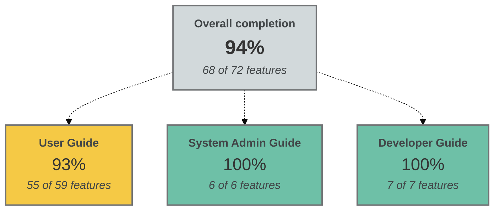
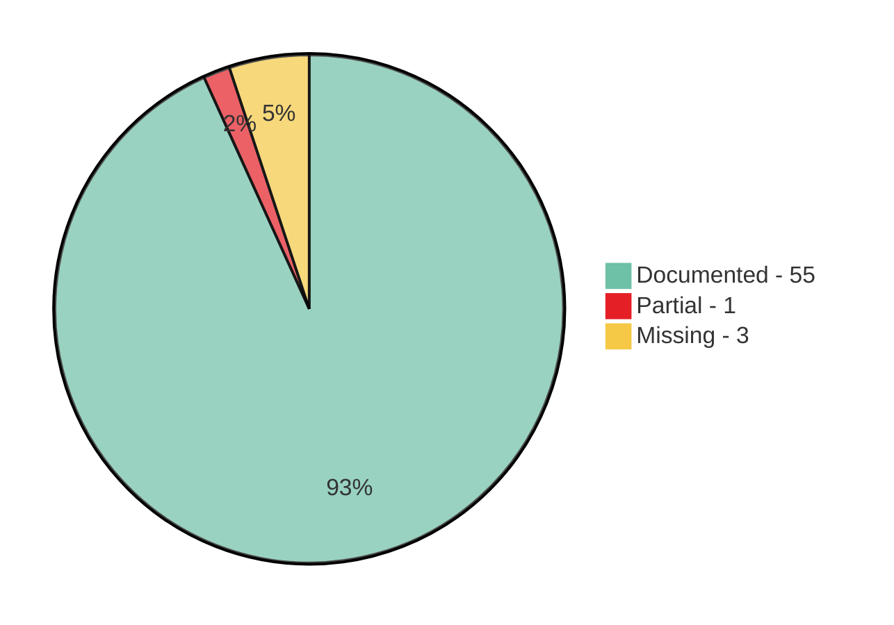

# Documentation coverage tracker

This page tracks the documentation coverage for Metadata Capture features.

## Overview

**Overall Coverage:** 68 Documented | 1 Partial | 3 Missing

---

## User Guide

User Guide documentation coverage: Overall Coverage: 55 Documented | 1 Partial | 3 Missing

 
**Status legend:**
- **🟩 Documented:** Complete documentation exists
- **🟧 Partial:** Documentation exists but may need updates or expansion
- **🟥 Missing:** No documentation exists

### Authentication and authorisation

| Status | Feature | Location | Comments |
|--------|---------|----------|----------|
| 🟩 | Sign in | /user-guide/sign-in | |
| 🟩 | Role-based access control | /user-guide/roles-and-permissions | Role-permission matrix not required - configurable upon deployment |
| 🟩 | Permission checking | /user-guide/check-your-permissions | |
| 🟧 | Organisation switching | /user-guide/dashboard-overview | Mentioned in dashboard overview; self-explanatory |
| 🟩 | First-time login flow | /user-guide/sign-in |   |

### Dataset management (Core)

| Status | Feature | Location | Comments |
|--------|---------|----------|----------|
| 🟩 | Create dataset | /user-guide/add-a-dataset | |
| 🟩 | Bulk upload datasets | /user-guide/add-a-dataset | |
| 🟩 | Edit dataset | /user-guide/add-a-dataset | |
| 🟩 | View dataset list | /user-guide/dashboard-overview | |
| 🟩 | Filter datasets | /user-guide/dashboard-overview | |
| 🟩 | Search datasets | /user-guide/dashboard-overview | |
| 🟩 | Dataset preview | /user-guide/dashboard-overview | |
| � | Clone dataset | /user-guide/duplicate-datasets | Comprehensive guide covering duplication workflow, use cases, and differences from versioning |

### Dataset record lifecycle (Status changes)

| Status | Feature | Location | Comments |
|--------|---------|----------|----------|
| 🟩 | Submit for review | /user-guide/add-a-dataset | |
| 🟩 | Validate dataset | /user-guide/validate-a-dataset | |
| 🟩 | Approve dataset | /user-guide/approve-a-dataset | |
| 🟩 | Publish dataset | /user-guide/publish-a-dataset | |
| 🟩 | Mark as internal | /user-guide/mark-datasets-as-internal | |
| 🟩 | Move from internal to public | /user-guide/move-from-internal-to-public | |
| 🟩 | Unpublish dataset | /user-guide/unpublish-a-dataset | |
| 🟩 | Deprecate dataset | /user-guide/deprecate-datasets | |
| 🟩 | Revert to draft | /user-guide/revert-a-dataset-to-draft | |

### Dataset enhancements

| Status | Feature | Location | Comments |
|--------|---------|----------|----------|
| 🟩 | Add distributions | /user-guide/add-distributions | |
| 🟩 | Edit distributions | /user-guide/add-distributions | |
| 🟩 | Delete distributions | /user-guide/add-distributions | |
| 🟩 | Add data dictionary | /user-guide/add-a-data-dictionary | |
| 🟩 | Upload data dictionary (Excel) | /user-guide/add-a-data-dictionary | Covered: Download Template and Bulk Upload using Excel template |
| 🟩 | Edit data dictionary fields | /user-guide/add-a-data-dictionary | |
| 🟩 | Delete data dictionary entries | /user-guide/add-a-data-dictionary | |
| 🟥 | Reorder data dictionary entries | | Feature exists (frontend with up/down arrows, backend API) but not documented |
| 🟥 | Export data dictionary | |  |
| 🟩 | Add dataset relations | /user-guide/manage-dataset-relations | |
| 🟩 | Delete dataset relations | /user-guide/manage-dataset-relations | |
| 🟩 | Add external relations | /user-guide/manage-dataset-relations | |
| 🟩 | Add qualified attributions | /user-guide/add-qualified-attributions | |
| 🟩 | Edit qualified attributions | /user-guide/add-qualified-attributions | |
| 🟩 | Delete qualified attributions | /user-guide/add-qualified-attributions | |
| 🟩 | Assign authentic source | /user-guide/assign-authentic-source | |
| 🟩 | Remove authentic source | /user-guide/assign-authentic-source | |

### Dataset metadata fields

| Status | Feature | Location | Comments |
|--------|---------|----------|----------|
| 🟩 | Basic information | /user-guide/add-a-dataset | |
| 🟩 | Keywords | /user-guide/add-a-keyword | |
| 🟩 | Themes | /user-guide/add-a-dataset | Standard DCAT-AP-LU vocabulary field; dropdown selection covered in add-a-dataset guide |
| 🟩 | Temporal coverage | /user-guide/add-a-dataset | Standard DCAT-AP-LU vocabulary field; date picker covered in add-a-dataset guide |
| 🟩 | Spatial coverage | /user-guide/add-a-dataset | Standard DCAT-AP-LU vocabulary field; dropdown selection covered in add-a-dataset guide |
| 🟩 | Update frequency | /user-guide/add-a-dataset | Standard DCAT-AP-LU vocabulary field; dropdown selection covered in add-a-dataset guide |
| 🟩 | Languages | /user-guide/add-a-dataset | Standard DCAT-AP-LU vocabulary field; dropdown selection covered in add-a-dataset guide |
| 🟩 | Legal basis | /user-guide/add-legislation | |
| 🟩 | Data protection types | /user-guide/add-a-dataset | Standard DCAT-AP-LU vocabulary field; dropdown selection covered in add-a-dataset guide |
| 🟩 | Access rights | /user-guide/add-a-dataset | Standard DCAT-AP-LU vocabulary field; dropdown selection covered in add-a-dataset guide |
| 🟩 | Series membership | /user-guide/add-a-dataset | Standard DCAT-AP-LU vocabulary field; dropdown selection covered in add-a-dataset guide |
| � | Versioning | /user-guide/create-dataset-versions | Comprehensive guide covering version creation, version history viewing, comparison, and stakeholder notifications |

### Organisation management

| Status | Feature | Location | Comments |
|--------|---------|----------|----------|
| 🟩 | Create organisation | /user-guide/add-organisations | |
| 🟩 | Edit organisation | /user-guide/add-organisations | |
| 🟩 | Archive organisation | /user-guide/add-organisations | |
| 🟩 | Add contacts | /user-guide/add-contacts | |
| 🟩 | Edit contacts | /user-guide/add-contacts | |
| 🟩 | Delete contacts | /user-guide/add-contacts | |
| 🟩 | Archive contacts | /user-guide/add-contacts | |

### Vocabulary management

| Status | Feature | Location | Comments |
|--------|---------|----------|----------|
| 🟩 | Add keywords | /user-guide/add-a-keyword | |
| 🟩 | Edit keywords | /user-guide/add-a-keyword | |
| 🟩 | Delete keywords | /user-guide/add-a-keyword | |
| 🟩 | Archive keywords | /user-guide/add-a-keyword | |
| 🟩 | Add legislation (Legilux) | /user-guide/add-legislation | |
| 🟩 | Add legislation (EUR-Lex) | /user-guide/add-legislation | |
| 🟩 | Edit legislation | /user-guide/add-legislation | |
| 🟩 | Delete legislation | /user-guide/add-legislation | |

### Comments and collaboration

| Status | Feature | Location | Comments |
|--------|---------|----------|----------|
| 🟩 | Add dataset comments | /user-guide/view-and-manage-comments | Comprehensive guide with best practices; also referenced in workflow action pages |
| 🟩 | Delete comments | /user-guide/view-and-manage-comments | Documented with permission requirements and audit implications |
| 🟩 | View comment history | /user-guide/view-and-manage-comments | Complete guide on viewing and navigating comment history |

### Activity logs and audit

| Status | Feature | Location | Comments |
|--------|---------|----------|----------|
| � | View dataset activity log | /user-guide/track-changes | Comprehensive guide including how to access, read entries, and common use cases |
| 🟥 | View organisation activity log | | Feature exists in code but no user-facing UI documentation needed at this time |
| 🟥 | View user activity log | | Feature exists in code but no user-facing UI documentation needed at this time |
| 🟥 | Filter activity logs | | Feature not available in current version; pagination only |
| 🟥 | Export activity logs | | Feature not available in current version |

## System Admin Guide (Deployment)

**System Admin Guide coverage:** 🟩 6 Documented | 🟧 0 Partial | 🟥 0 Missing  

### Configuration and deployment

| Status | Feature | Location | Comments |
|--------|---------|----------|----------|
| 🟩 | Architecture overview | /docs-system-admin/architecture-overview | |
| 🟩 | Deployment | /docs-system-admin/deploy-metadata-capture | |
| 🟩 | Application configuration | /docs-system-admin/configure-the-application | |
| 🟩 | Roles and permissions configuration | /docs-system-admin/configure-roles-and-permissions | |
| 🟩 | Email notifications | /docs-system-admin/configure-email-notifications | |
| 🟩 | Authentication setup | /docs-system-admin/set-up-authentication | |

## Developer Guide

**Developer Guide coverage:** 🟩 7 Documented | 🟧 0 Partial | 🟥 0 Missing  

| Status | Feature | Location | Comments |
|--------|---------|----------|----------|
| 🟩 | Environment setup | /docs-developer/set-up-a-developer-env | |
| 🟩 | Local authentication | /docs-developer/set-up-local-authentication | |
| 🟩 | Database operations | /docs-developer/work-with-the-databse | |
| 🟩 | Running tests | /docs-developer/run-tests | |
| 🟩 | API schema synchronization | /docs-developer/synchronise-api-schemas | |
| 🟩 | Run app on Windows | /docs-developer/run-app-on-windows | |
| 🟩 | Changelog | /docs-developer/CHANGELOG | Version history and release notes |

---

## Other technical features

This section lists features that are not documented for the following reasons:

- **Backend-only features** (no user interface and purely technical)
- **No current plans to document** (out of scope for this version)

### Data services (Access services)

| Feature | Comments |
|---------|----------|
| Add data service  | Advanced DCAT-AP feature; self-explanatory form in dataset editor |
| Edit data service  | Advanced DCAT-AP feature; self-explanatory form in dataset editor |
| Link to distribution  | Advanced DCAT-AP feature; self-explanatory dropdown in data service form |

### Integration features

| Feature | Comments |
|---------|-------|
| Service account authentication | Technical integration feature; covered in system admin/developer docs |
| RDF import | Feature exists (async endpoint at POST /api/v1/datasets/import) but no user guide documentation available |
| Legislation search integration (Legilux) | Covered in /user-guide/add-legislation but missing detailed explanation of search functionality and API integration specifics |
| Legislation search integration (EUR-Lex) | Covered in /user-guide/add-legislation but missing detailed explanation of search functionality and API integration specifics |
| Publish to front office | Covered in /user-guide/publish-a-dataset but only brief mention as external portal integration; no detailed front office documentation |
| Export catalogue (DCAT-AP RDF) | System-level export feature; technical API endpoint; covered in developer/system admin docs |
| Export single dataset (RDF) | System-level export feature; technical API endpoint; covered in developer/system admin docs |
| Export catalogue (JSON-LD) | System-level export feature; technical API endpoint; covered in developer/system admin docs |
| Preview catalogue | System-level feature; technical API endpoint for catalogue preview |
| Catalogue formats | Technical specification; covered by DCAT-AP-LU standards documentation |
| Health check | Technical API endpoint; covered in developer/API documentation |
| Antivirus scanning | Backend security feature; automatic ClamAV integration; covered in deployment docs |
| Front office directory | External system integration; not part of Metadata Capture user guide scope |
| Configure publishing targets | System admin configuration feature; covered in system admin guide |

### Backend automation and processing

| Feature | Comments |
|---------|-------|
| Session management | Technical backend feature; handled automatically by the system |
| Distribution policy actions | Technical/backend feature; not user-facing action |
| Keyword usage tracking | Backend feature; system automatically prevents deletion of keywords in use |
| Automatic publishing on status change | Backend automation feature; happens automatically when dataset is published |

### System-level configuration 

| Feature | Comments |
|---------|-------|
| Configuration management | Covered comprehensively in 'Application configuration' guide |
| Email notifications (system) | Covered in 'Email notifications' configuration guide |
| Feature flags | Technical configuration; covered in application configuration guide |
| Form field customisation | System admin configuration feature; covered in system admin guide |
| Manage organisation users | Admin function handled through identity management system (Keycloak); covered in system admin guide |
| User list | Admin function handled through identity management system (Keycloak) |
| Assign roles | Admin function handled through identity management system (Keycloak) |
| Remove roles | Admin function handled through identity management system (Keycloak) |
| Assign to dataset | Dataset-level user assignment; may be covered in dataset management |
| Remove from dataset | Dataset-level user removal; may be covered in dataset management |
| View user profile | User profile viewing; may be self-explanatory or covered in authentication setup |

### DCAT-AP-LU vocabulary fields

| Feature | Comments |
|---------|-------|
| Themes | Standard DCAT-AP-LU vocabulary field; dropdown selection covered in add-a-dataset guide |
| Temporal coverage | Standard DCAT-AP-LU vocabulary field; date picker covered in add-a-dataset guide |
| Spatial coverage | Standard DCAT-AP-LU vocabulary field; dropdown selection covered in add-a-dataset guide |
| Update frequency | Standard DCAT-AP-LU vocabulary field; dropdown selection covered in add-a-dataset guide |
| Languages | Standard DCAT-AP-LU vocabulary field; dropdown selection covered in add-a-dataset guide |
| Data protection types | Standard DCAT-AP-LU vocabulary field; dropdown selection covered in add-a-dataset guide |
| Access rights | Standard DCAT-AP-LU vocabulary field; dropdown selection covered in add-a-dataset guide |
| Series membership | Standard DCAT-AP-LU vocabulary field; dropdown selection covered in add-a-dataset guide |

### System-level user management

| Feature | Comments |
|--------|---------|
| User list | Admin function handled through identity management system (Keycloak) |
| Assign roles | Admin function handled through identity management system (Keycloak) |
| Remove roles | Admin function handled through identity management system (Keycloak) |
| Assign to dataset | Dataset-level user assignment; may be covered in dataset management |
| View user profile | User profile viewing; may be self-explanatory or covered in authentication setup |

## About this tracker

This documentation tracker was compiled through a code analysis of the Metadata Capture application:

1. **Backend API Analysis**: Examined all API endpoints in `app/routes/` to identify available features and functionality
2. **Frontend UI Review**: Analyzed React components in `app/client/src/` to discover user-facing features and interactions
3. **Documentation Audit**: Cross-referenced existing documentation files in `/user-guide/`, `/docs-system-admin/`, and `/docs-developer/` to determine coverage
4. **Feature Categorization**: Organized features into logical groups based on their purpose (authentication, dataset management, workflows, etc.)
5. **Status Assessment**: Evaluated each feature against existing documentation to assign status:
   - 🟩 **Documented**: Complete guide exists with clear instructions
   - 🟧 **Partial**: Feature mentioned but lacks detailed explanation
   - 🟥 **Missing**: No documentation found for existing feature

Features marked as "**Other technical features**" are intentionally excluded from coverage statistics as they are either backend-only implementations (no user interface) or out of scope for this version.
