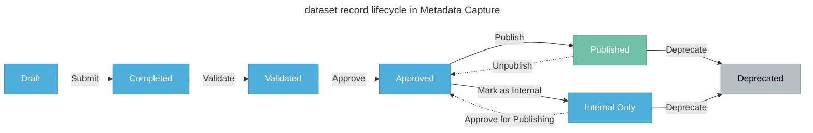

import FeatureFlag from '@site/src/components/FeatureFlag';

# The dataset record lifecycle

Use this guide to understand the workflow for managing datasets in Metadata Capture. Also see: [What is a dataset?](/user-guide/what-is-a-dataset)

Dataset records in Metadata capture go through a multi‑stage lifecycle focusing on approvals to ensure datasets are properly documented before publication. This lifecycle defines the workflow for managing datasets from creation to publication and eventual deprecation.  

The following diagram illustrates the dataset record lifecycle in Metadata Capture. The boxes represent the lifecycle **stages**, and the arrows indicate the **actions** required to move the datasets to the next stage. Each stage represents a tab in the [dataset panel](/user-guide/dashboard-overview#dataset-panel), where you can manage datasets based on their current state.

 

:::tip Other actions

- You can [revert datasets to draft](/user-guide/revert-a-dataset-to-draft) at any stage except for Published and Internal Only stages. 
- You can only publish datasets from [Internal Only to Public](/user-guide/make-internal-datasets-public) by first moving them back to the Approved state.

:::

 

The following table describes how datasets progress through each stage from creation (draft) to publication and deprecation, and the steps involved in each stage:

<FeatureFlag flag="enable_multi_tenants">

| Action | Stage  | Resulting State  |
|--------|-------|-------------|
| Add a dataset  | **Draft** | Dataset is being added or edited.|
| Submit the dataset  | **Completed** | Dataset has been submitted for review. |
| Validate the dataset   | **Validated** | The accuracy of dataset has been confirmed, and is awaiting approval. |
| Approve the dataset  | **Approved** | The dataset meets relevant publication standards, and is awaiting publication. |
| Publish the dataset as public  | **Published** | Dataset is published and accessible to all organisations. |
| Mark the dataset as internal  | **Internal Only** | Dataset is published and only accessible within the organisation. |
| Deprecate the dataset   | **Deprecated** | Dataset is no longer used or has been replaced by newer versions. |

</FeatureFlag>

<!-- Public -->
<FeatureFlag flag="enable_multi_tenants" inverse>

| Action | Stage  | Resulting State  |
|--------|-------|-------------|
| Add a dataset  | **Draft** | Dataset is being added or edited.|
| Submit the dataset  | **Completed** | Dataset has been submitted for review. |
| Validate the dataset   | **Validated** | The accuracy of dataset has been confirmed, and is awaiting approval. |
| Approve the dataset  | **Approved** | The dataset meet the publication standards, and is awaiting publication. This can include fulfilling legal requirements or other organisational policies. |
| Publish the dataset as public  | **Published** | Dataset is published and accessible to all organisations. |
| Mark the dataset as internal  | **Internal Only** | Dataset is published and only accessible within the organisation. |
| Deprecate the dataset   | **Deprecated** | Dataset is no longer used or has been replaced by newer versions. |

</FeatureFlag>

:::info Roles and permissions

Your role determines the actions you can perform and how you can interact with a dataset. Some actions are only available to specific roles. To learn about the available roles and the actions you can perform, see: [Roles and permissions](/user-guide/roles-and-permissions).
