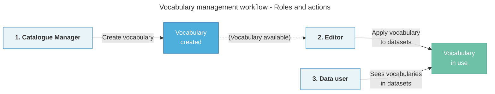

# About vocabularies

In this guide

> [Overview](#overview)  
> [How vocabularies work](#how-vocabularies-work)

## Overview

**Vocabularies** are controlled sets of terms used to describe and categorise datasets in your catalogue. They ensure consistent terminology across your organisation, making datasets easier to find and understand. 

You can manage two types of vocabularies:

- **[Keywords](/user-guide/add-a-keyword):** Terms that describe dataset content and subject matter (e.g., *health*, *education*, *transportation*). Improve dataset discoverability through search and filtering.
- **[Applicable legislations](/user-guide/add-legislation):** Legal frameworks and regulations that datasets must adhere to. The platform integrates with [Legilux↗](https://legilux.public.lu/) and [EUR-Lex↗](https://eur-lex.europa.eu/) for authentic legal references.

## How vocabularies work

Vocabulary management follows a three-stage workflow, illustrated below.

 

1. **Catalogue Managers:** (Or equivalent roles) Create and manage vocabularies to maintain consistency. You can only delete vocabularies that are not in use.
2. **Editors:** Use vocabularies to tag datasets, enhancing discoverability and compliance. 
3. **Data users:** Benefit from improved search and filtering capabilities for datasets tagged with vocabularies.

:::info Role names may vary

Role names like "**Catalogue Managers**" or "**Editors**" can vary depending on your organisational setup. If you're unsure, learn about [roles and permissions](/user-guide/roles-and-permissions) or contact your system administrator.

:::
