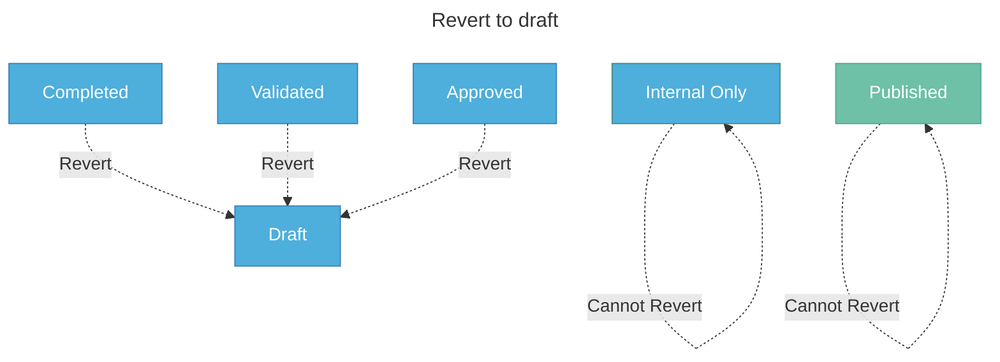

import useBaseUrl from '@docusaurus/useBaseUrl';

# Revert datasets to draft

In this guide
> [Overview](#overview)  
> [Revert a dataset to draft](#revert-a-dataset-to-draft) 
## Overview

Revert datasets to their draft state at any stage in the workflow to make corrections or updates before continuing through the approval process. Use this option when you need to make significant changes or address issues identified during review. This allows you to address feedback, add missing information, or fix errors identified during review.

**How it works:**

- Datasets can be reverted from Completed, Validated, or Approved stages
- Published and Internal Only datasets cannot be reverted to draft
- For internal datasets, first approve them for publishing to move them to the Approved state, then revert
- Reverting sends the dataset back to the Draft tab where you can make edits

The following diagram illustrates which stages allow reverting to draft:

To understand the full dataset record lifecycle, see the [dataset record lifecycle](/user-guide/key-concepts/the-dataset-record-lifecycle).

## Revert a dataset to draft

To revert a dataset to draft, you must be a Catalogue Manager or have the permission to **return datasets to draft**. Check your [permissions](/user-guide/check-your-permissions).

1. Search for the dataset you want to revert, or manually locate them in the datasets panel.

2. Select **View** on the dataset you want to revert. 

   

3. Select **Revert to Draft**. The comment box appears.

4. (Optional) Enter a comment explaining why you are reverting the dataset to draft state.

5. Select **Revert to Draft** to confirm. After the dataset is reverted, it appears on the **Draft** tab, and is ready for further edits.

   

